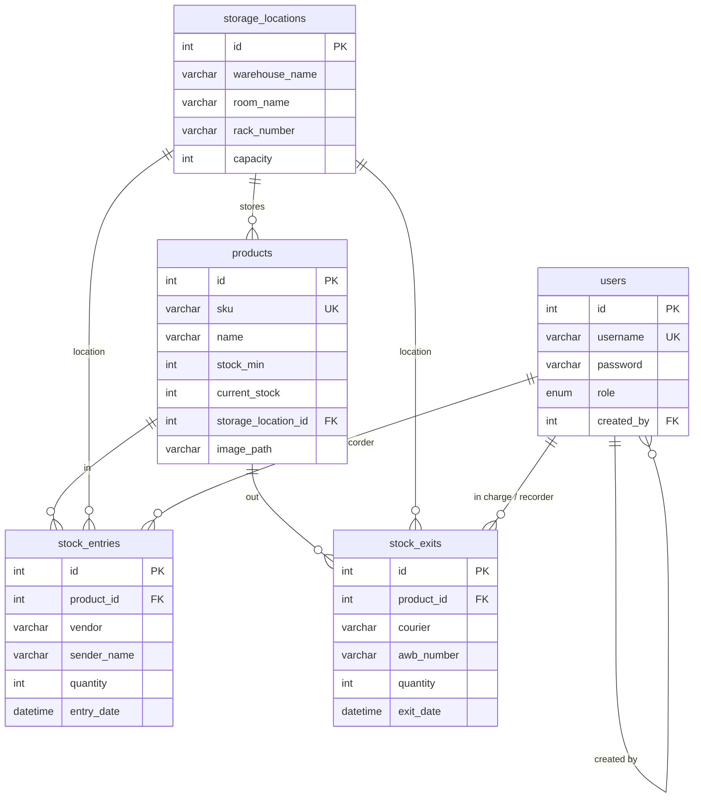
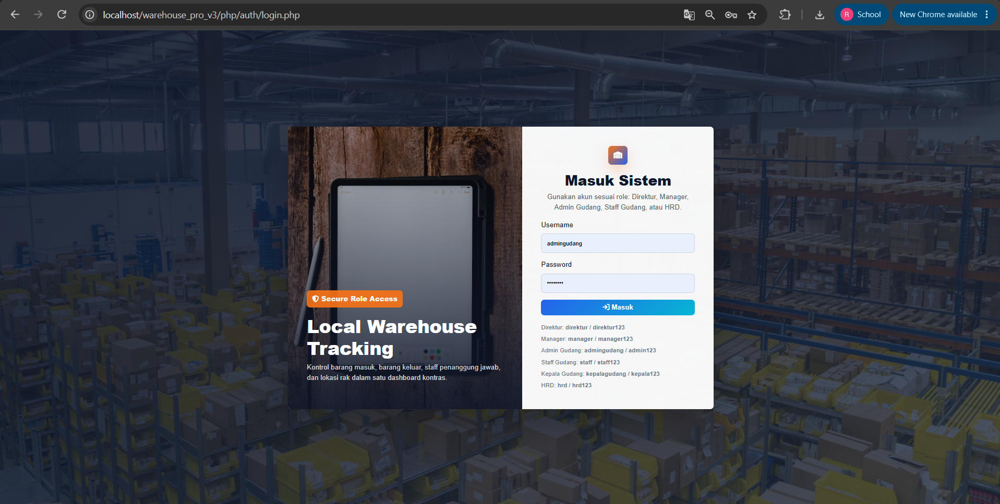
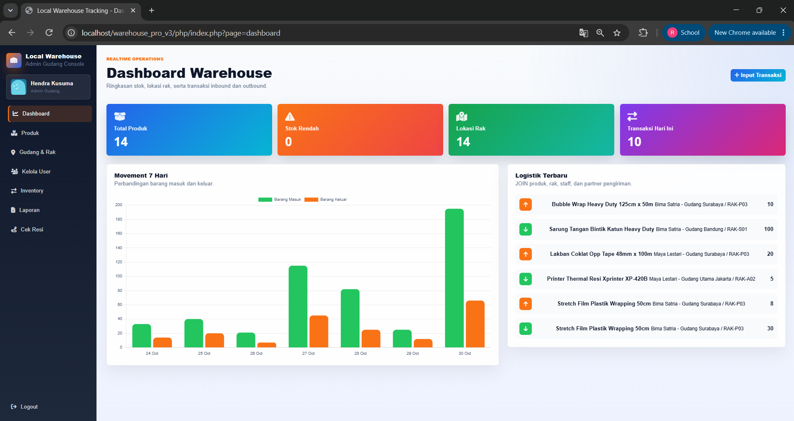
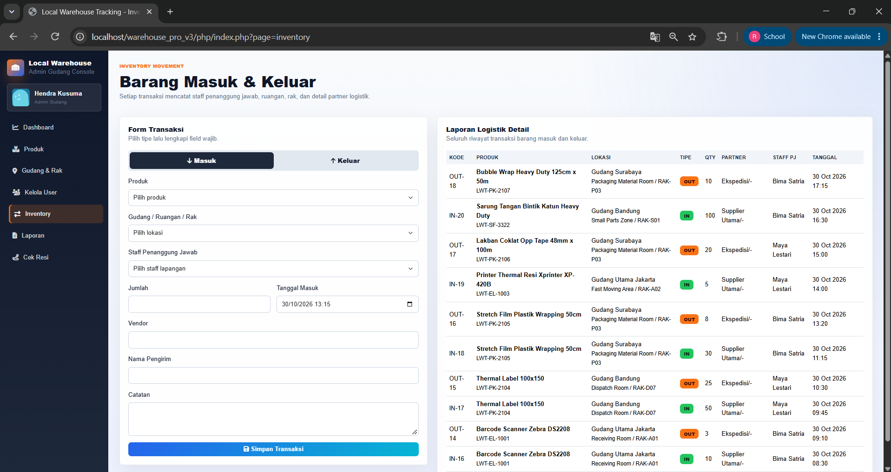
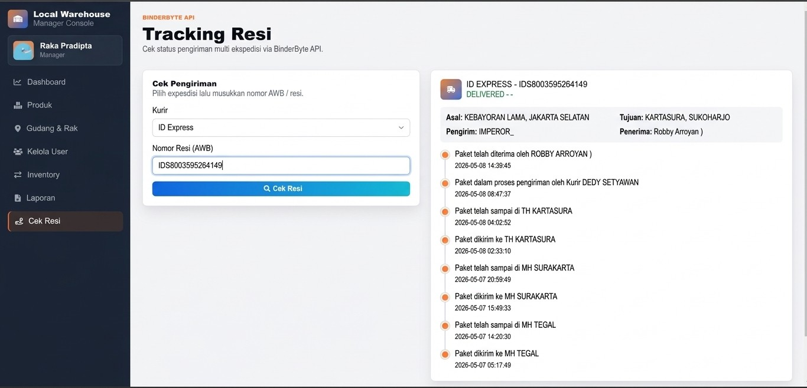

[🇮🇩 Bahasa Indonesia](README.md) | 🇬🇧 English

# Local Warehouse Tracking (Warehouse Pro v3)

A web-based warehouse management system for recording incoming goods, outgoing goods, rack locations, and shipment tracking in a single dashboard. Built with native PHP, MySQL/MariaDB, and vanilla JavaScript, with role-based access control.


---

## Background

Manual stock recording (notebooks or spreadsheets) often causes problems. Stock does not match what is actually on the racks, it is unclear who is responsible for a given transaction, and shipment status has to be checked one by one on each courier's website.

This project tries to address those problems by:

1. Recording every incoming and outgoing transaction along with the rack location and the responsible staff member.
2. Updating stock automatically and rejecting outgoing transactions that exceed available stock.
3. Restricting features by job role, so field staff only see their own work.
4. Providing multi-courier shipment tracking directly inside the system.

---

## Key Features

**Dashboard**
- Summary cards: total products, number of low-stock products, number of rack locations, and today's transactions.
- Trend chart of incoming and outgoing goods over the last 7 days (Chart.js).
- List of the 6 most recent transactions.

**Inventory (Stock In and Out)**
- One form for both transaction types. Fields change automatically depending on whether In or Out is selected.
- Incoming goods record the vendor, sender name, and entry date.
- Outgoing goods record the courier, tracking number, destination, and exit date.
- The rack location is filled in automatically from the selected product's last known location.
- For warehouse staff, the person in charge is filled in automatically with their own name.

**Product Management**
- Product CRUD with unique SKU, unit, minimum stock, and storage location.
- Product photo upload with preview before saving.
- Real-time product search (by name or SKU) without reloading the page.

**Warehouse and Racks**
- Storage location CRUD (warehouse, room, rack number, capacity, notes).
- The combination of warehouse, room, and rack is enforced as unique at the database level.

**Product Categories**
- CRUD for category master data.

**User Management**
- User CRUD with 6 roles and tiered account creation rules.
- Profile photo with an automatic DiceBear avatar fallback when none is uploaded.
- Passwords are stored as hashes.

**Reports**
- Combined history of incoming and outgoing goods (up to the 500 most recent rows).
- Warehouse staff only see reports for their own transactions.

**Shipment Tracking**
- BinderByte API integration for 13 couriers (JNE, J&T, SiCepat, POS, TIKI, Anteraja, SPX, and others).
- Automatic courier detection from the tracking number pattern.
- Package journey timeline view.

---

## Roles and Permissions

| Feature | Director | Manager | Head of Warehouse | Warehouse Admin | HR | Warehouse Staff |
|---|:-:|:-:|:-:|:-:|:-:|:-:|
| Dashboard | ✅ | ✅ | ✅ | ✅ | ✅ | ✅ |
| Inventory (transaction input) | ✅ | ✅ | ✅ | ✅ | ✅ | ✅ |
| Reports | all | all | all | all | all | own only |
| Shipment Tracking | ✅ | ✅ | ✅ | ✅ | ✅ | ✅ |
| Products, Warehouse and Racks, Categories | ✅ | ✅ | ✅ | ✅ | ❌ | ❌ |
| User Management | ✅ | ✅ | ✅ | ✅ | edit only | ❌ |

Rules for creating new accounts:

| Creator | Roles they can create |
|---|---|
| Director | Manager, Head of Warehouse, Warehouse Admin, Warehouse Staff, HR |
| Manager | Head of Warehouse, Warehouse Admin, Warehouse Staff, HR |
| Head of Warehouse | Warehouse Admin, Warehouse Staff |
| Warehouse Admin | Warehouse Staff |
| HR and Warehouse Staff | cannot add users |

---

## Tech Stack

| Layer | Technology |
|---|---|
| Backend | PHP 8.2 (native, procedural), `mysqli` with prepared statements |
| Database | MariaDB 10.4 / MySQL (InnoDB, foreign keys) |
| Frontend | HTML5, CSS3, JavaScript (vanilla), Bootstrap 5.3.2, Font Awesome 6.5.1 |
| Visualization | Chart.js 4.4.0 |
| External APIs | BinderByte (shipment tracking), DiceBear 8.x (default avatars) |
| Local environment | XAMPP / Laragon (Apache + MariaDB) |

---

## Folder Structure

```
warehouse_pro_v3/
├── php/
│   ├── index.php              # Front controller, page routing and role checks
│   ├── assets/
│   │   ├── css/style.css      # All application styling
│   │   └── js/script.js       # Client-side logic (validation, live search, tracking)
│   ├── auth/
│   │   ├── login.php
│   │   └── logout.php
│   ├── config/
│   │   ├── koneksi.php        # Database connection
│   │   ├── config.php         # Alias to koneksi.php
│   │   ├── auth.php           # Alias to functions.php
│   │   └── functions.php      # Role helpers, avatars, dashboard stats, tracking utilities
│   ├── layout/                # header, sidebar, footer
│   ├── modules/
│   │   ├── dashboard.php
│   │   ├── inventory.php
│   │   ├── produk.php
│   │   ├── product_search.php # JSON endpoint for product search
│   │   ├── categories.php
│   │   ├── storage_locations.php
│   │   ├── users.php
│   │   ├── laporan.php
│   │   ├── tracking.php
│   │   └── tracking_api.php   # Server-side proxy to the BinderByte API
│   └── uploads/
│       ├── avatars/
│       └── products/
├── docs/screenshots/          # Screenshots for the README
├── warehouse_pro.sql          # Database schema and seed data
├── .gitignore
├── README.md
└── README.en.md
```

---

## Core Logic

### 1. Atomic stock transactions
Every incoming or outgoing transaction performs two operations together: an insert into `stock_entries` or `stock_exits`, then an update to `products.current_stock`. Both are wrapped in `begin_transaction()` and `commit()`. If either one fails, `rollback()` is called so the stock never diverges from the transaction history.

```
Form input → validation → begin_transaction
           → INSERT history (entries / exits)
           → UPDATE current_stock (+qty for IN, -qty for OUT)
           → commit  (or rollback on error)
```

### 2. Two-layer validation
- **Client (JavaScript):** required fields are checked live, and the outgoing quantity is compared against the product's stock before the form is submitted.
- **Server (PHP):** the same validation is repeated because browser-side checks can be bypassed. Outgoing quantities that exceed stock are rejected.

### 3. Layered access control
Access is checked in three places. `index.php` uses a page whitelist and `require_role()`, the sidebar hides menus that are not relevant, and modules such as `users.php` re-check special rules (for example, HR may not add or delete users). For warehouse staff, the report query is filtered by the person in charge.

### 4. Logistics history with `UNION ALL`
Incoming and outgoing records live in two separate tables, so they are merged with `UNION ALL` and sorted by date. This query is used on the dashboard, inventory page, and reports.

### 5. Automatic courier detection
In automatic mode, the `tracking_auto_couriers()` function reads the tracking number prefix with a regex (for example, the `SPX` prefix points to Shopee Express) and orders the most likely couriers first. The server then tries each courier one by one until BinderByte returns data.

### 6. The API key never reaches the browser
The browser calls `modules/tracking_api.php`, and the PHP server forwards the request to BinderByte using cURL. This way the API key only exists on the server side.

### 7. Live search with debounce
The product search box waits 280 ms after the user stops typing before calling `product_search.php`, which reduces the number of requests to the server. Results are re-rendered with the `escapeHtml()` function to prevent XSS.

### 8. Basic security
- All queries use prepared statements.
- Passwords use `password_hash()` and `password_verify()`.
- `session_regenerate_id(true)` is called after a successful login.
- Text input is sanitized with `htmlspecialchars` through `clean_input()`.
- Product photo and profile photo uploads check the real MIME type of the file with `mime_content_type()`, limit the size to 2 MB, and determine the extension from the MIME type rather than the file name.
- The JSON endpoint (`product_search.php`) returns 401 when the user is not logged in.

---

## Database Schema



---

## Getting Started

### Prerequisites
- PHP 8.0 or newer (with the `mysqli`, `curl`, and `fileinfo` extensions enabled)
- MariaDB 10.4+ or MySQL 5.7+
- XAMPP or Laragon

### Steps
1. Clone the repository into your web server folder.
   ```bash
   git clone https://github.com/indrwjyn/warehouse-pro-v3.git
   ```
   For XAMPP, place it in `C:\xampp\htdocs\`.

2. Create the database and import the schema.
   ```sql
   CREATE DATABASE warehouse_pro CHARACTER SET utf8mb4;
   ```
   Then import `warehouse_pro.sql` through phpMyAdmin (Import menu) or the CLI:
   ```bash
   mysql -u root warehouse_pro < warehouse_pro.sql
   ```

3. Adjust the connection in `php/config/koneksi.php` if your MySQL credentials differ from the default (`root` with no password).

4. Set the BinderByte API key (see the section below).

5. Make sure the `php/uploads/avatars/` and `php/uploads/products/` folders are writable by the web server.

6. Open `http://localhost/warehouse-pro-v3/php/` in your browser.

### Configuring the BinderByte API key
Sign up at [binderbyte.com](https://binderbyte.com) to get an API key. The application reads the key from the `BINDERBYTE_API_KEY` environment variable.

Example for Apache (`httpd.conf` or `.htaccess`):
```apache
SetEnv BINDERBYTE_API_KEY "your_api_key_here"
```

Do not write the API key directly in the source code and do not commit it to the repository.

### Demo Accounts

These accounts come from the seed data and are for local demo purposes only.

| Role | Username | Password |
|---|---|---|
| Director | `direktur` | `direktur123` |
| Manager | `manager` | `manager123` |
| Head of Warehouse | `kepalagudang` | `kepala123` |
| Warehouse Admin | `admingudang` | `admin123` |
| Warehouse Staff | `staff` | `staff123` |
| HR | `hrd` | `hrd123` |

---

## Screenshots

| Login | Dashboard |
|---|---|
|  |  |

| Inventory | Shipment Tracking |
|---|---|
|  |  |

---

## Development Team

| Name | Responsibilities |
|---|---|
| **Raden Bagus Indra Wijaya Nugraha** | Project idea, JavaScript logic, SQL database, PHP configuration (`config/`), `inventory` and `categories` modules |
| **Robby Arroyan Nur Hakim** | Authentication (`auth/`), layout, `dashboard`, `tracking`, and `tracking_api` modules |
| **Vicko Bachtiar Nurrahmat** | CSS styling, upload features (`uploads/`), `product_search`, `produk`, `storage_locations`, and `users` modules |

The idea and initial concept for this project came from Raden Bagus Indra Wijaya Nugraha, and the team then developed it together.

---

## Limitations and Future Work

Some things that can still be improved in the next version:

- [ ] Delete actions still use GET links. They should be changed to POST with a CSRF token.
- [ ] Reports have no pagination yet and the display is still capped at 500 rows.
- [ ] No report export to PDF or Excel yet.
- [ ] No unit tests or CI yet.
- [ ] Products without a photo still depend on a third-party image service. A local placeholder is needed.
- [ ] The database connection is still written directly in `koneksi.php`. It should be moved to environment variables.

---

## License

Copyright © 2026 Raden Bagus Indra Wijaya Nugraha, Robby Arroyan Nur Hakim, and Vicko Bachtiar Nurrahmat. This project was created for learning and portfolio purposes.
