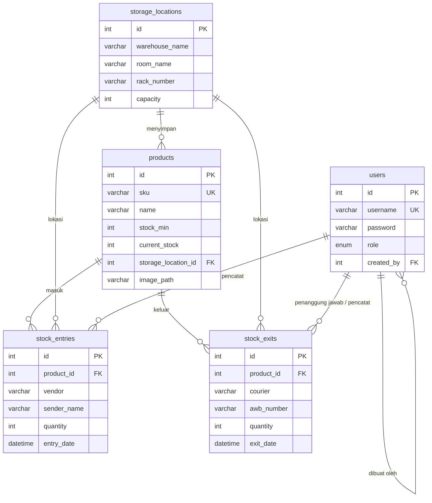
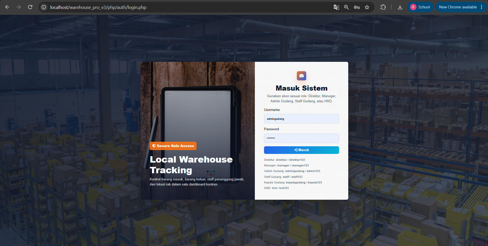
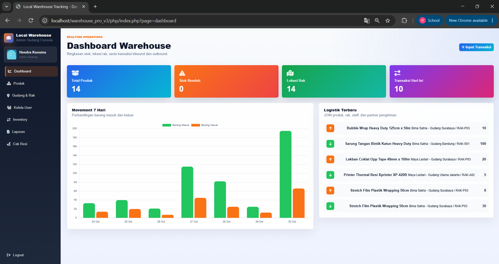
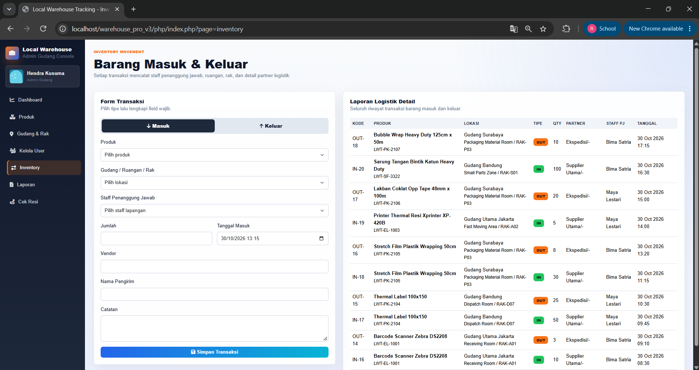
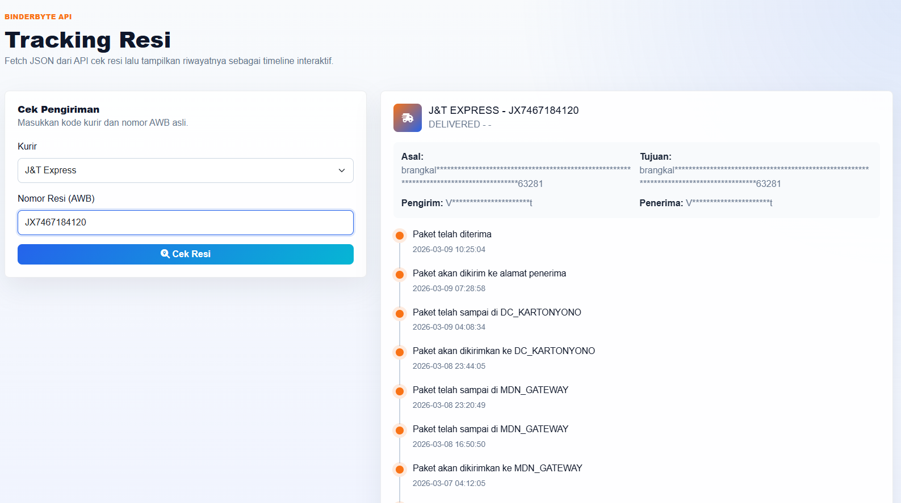

🇮🇩 Bahasa Indonesia | [🇬🇧 English](README.en.md)

# Local Warehouse Tracking (Warehouse Pro v3)

Sistem informasi manajemen gudang berbasis web untuk mencatat barang masuk, barang keluar, lokasi rak, dan pelacakan resi pengiriman dalam satu dashboard. Dibangun dengan PHP native, MySQL/MariaDB, dan JavaScript murni, dengan pembagian hak akses berdasarkan role.


---

## Latar Belakang

Pencatatan stok gudang yang masih manual (buku atau spreadsheet) sering bermasalah. Stok tidak sinkron dengan kondisi rak, tidak jelas siapa yang bertanggung jawab atas suatu transaksi, dan status pengiriman harus dicek satu per satu di situs ekspedisi.

Proyek ini mencoba menjawab masalah tersebut dengan:

1. Mencatat setiap transaksi masuk dan keluar lengkap dengan lokasi rak dan staff penanggung jawab.
2. Memperbarui stok otomatis dan menolak transaksi keluar yang melebihi stok.
3. Membatasi fitur sesuai jabatan, sehingga staff lapangan hanya melihat pekerjaannya sendiri.
4. Menyediakan cek resi multi ekspedisi langsung dari dalam sistem.

---

## Fitur Utama

**Dashboard**
- Kartu ringkasan: total produk, jumlah produk stok rendah, jumlah lokasi rak, dan transaksi hari ini.
- Grafik tren pergerakan barang masuk dan keluar selama 7 hari terakhir (Chart.js).
- Daftar 6 aktivitas transaksi terbaru.

**Inventory (Barang Masuk dan Keluar)**
- Satu form untuk dua tipe transaksi. Field berubah otomatis sesuai pilihan Masuk atau Keluar.
- Barang masuk mencatat vendor, nama pengirim, dan tanggal masuk.
- Barang keluar mencatat kurir, nomor resi, tujuan, dan tanggal keluar.
- Lokasi rak terisi otomatis dari lokasi terakhir produk yang dipilih.
- Untuk staff gudang, penanggung jawab terisi otomatis dengan namanya sendiri.

**Manajemen Produk**
- CRUD produk dengan SKU unik, satuan, stok minimum, dan lokasi penyimpanan.
- Upload foto produk dengan preview sebelum disimpan.
- Pencarian produk real-time (nama atau SKU) tanpa reload halaman.

**Gudang dan Rak**
- CRUD lokasi penyimpanan (gudang, ruangan, nomor rak, kapasitas, catatan).
- Kombinasi gudang, ruangan, dan rak dijaga unik di level database.

**Kategori Produk**
- CRUD kategori master data.

**Kelola User**
- CRUD user dengan 6 role dan aturan pembuatan akun berjenjang.
- Foto profil dengan fallback avatar otomatis dari DiceBear jika belum upload.
- Password disimpan dalam bentuk hash.

**Laporan**
- Riwayat gabungan barang masuk dan keluar (hingga 500 baris terbaru).
- Staff gudang hanya melihat laporan transaksi miliknya.

**Cek Resi**
- Integrasi BinderByte API untuk 13 ekspedisi (JNE, J&T, SiCepat, POS, TIKI, Anteraja, SPX, dan lainnya).
- Mode deteksi kurir otomatis dari pola nomor resi.
- Tampilan timeline perjalanan paket.

---

## Role dan Hak Akses

| Fitur | Direktur | Manager | Kepala Gudang | Admin Gudang | HRD | Staff Gudang |
|---|:-:|:-:|:-:|:-:|:-:|:-:|
| Dashboard | ✅ | ✅ | ✅ | ✅ | ✅ | ✅ |
| Inventory (input transaksi) | ✅ | ✅ | ✅ | ✅ | ✅ | ✅ |
| Laporan | semua | semua | semua | semua | semua | milik sendiri |
| Cek Resi | ✅ | ✅ | ✅ | ✅ | ✅ | ✅ |
| Produk, Gudang dan Rak, Kategori | ✅ | ✅ | ✅ | ✅ | ❌ | ❌ |
| Kelola User | ✅ | ✅ | ✅ | ✅ | edit saja | ❌ |

Aturan pembuatan akun baru:

| Pembuat | Boleh membuat role |
|---|---|
| Direktur | Manager, Kepala Gudang, Admin Gudang, Staff Gudang, HRD |
| Manager | Kepala Gudang, Admin Gudang, Staff Gudang, HRD |
| Kepala Gudang | Admin Gudang, Staff Gudang |
| Admin Gudang | Staff Gudang |
| HRD dan Staff Gudang | tidak bisa menambah user |

---

## Tech Stack

| Layer | Teknologi |
|---|---|
| Backend | PHP 8.2 (native, procedural), `mysqli` dengan prepared statement |
| Database | MariaDB 10.4 / MySQL (InnoDB, foreign key) |
| Frontend | HTML5, CSS3, JavaScript (vanilla), Bootstrap 5.3.2, Font Awesome 6.5.1 |
| Visualisasi | Chart.js 4.4.0 |
| API eksternal | BinderByte (tracking resi), DiceBear 8.x (avatar default) |
| Lingkungan lokal | XAMPP / Laragon (Apache + MariaDB) |

---

## Struktur Folder

```
warehouse_pro_v3/
├── php/
│   ├── index.php              # Front controller, routing halaman dan pengecekan role
│   ├── assets/
│   │   ├── css/style.css      # Seluruh styling aplikasi
│   │   └── js/script.js       # Logika sisi klien (validasi, live search, tracking)
│   ├── auth/
│   │   ├── login.php
│   │   └── logout.php
│   ├── config/
│   │   ├── koneksi.php        # Koneksi database
│   │   ├── config.php         # Alias ke koneksi.php
│   │   ├── auth.php           # Alias ke functions.php
│   │   └── functions.php      # Helper role, avatar, statistik dashboard, util tracking
│   ├── layout/                # header, sidebar, footer
│   ├── modules/
│   │   ├── dashboard.php
│   │   ├── inventory.php
│   │   ├── produk.php
│   │   ├── product_search.php # Endpoint JSON untuk pencarian produk
│   │   ├── categories.php
│   │   ├── storage_locations.php
│   │   ├── users.php
│   │   ├── laporan.php
│   │   ├── tracking.php
│   │   └── tracking_api.php   # Proxy server ke BinderByte API
│   └── uploads/
│       ├── avatars/
│       └── products/
├── docs/screenshots/          # Screenshot untuk README
├── warehouse_pro.sql          # Skema database dan data awal
├── .gitignore
├── README.md
└── README.en.md
```

---

## Logika Inti

### 1. Transaksi stok yang atomik
Setiap transaksi masuk atau keluar menjalankan dua operasi sekaligus, yaitu insert ke tabel `stock_entries` atau `stock_exits` lalu update `products.current_stock`. Keduanya dibungkus dalam `begin_transaction()` dan `commit()`. Jika salah satu gagal, `rollback()` dipanggil agar stok tidak pernah berbeda dengan riwayat transaksi.

```
Input form → validasi → begin_transaction
           → INSERT riwayat (entries / exits)
           → UPDATE current_stock (+qty untuk IN, -qty untuk OUT)
           → commit  (atau rollback jika error)
```

### 2. Validasi dua lapis
- **Klien (JavaScript):** field wajib dicek secara live, dan jumlah barang keluar dibandingkan dengan stok produk sebelum form dikirim.
- **Server (PHP):** validasi yang sama diulang karena validasi di browser bisa dilewati. Jumlah keluar yang melebihi stok ditolak.

### 3. Pembatasan akses berlapis
Akses dicek di tiga tempat. `index.php` memakai whitelist halaman dan `require_role()`, sidebar menyembunyikan menu yang tidak relevan, dan modul seperti `users.php` mengecek ulang aturan khusus (misalnya HRD tidak boleh menambah atau menghapus user). Untuk staff gudang, query laporan difilter berdasarkan nama penanggung jawab.

### 4. Riwayat logistik dengan `UNION ALL`
Riwayat masuk dan keluar berada di dua tabel berbeda, lalu digabung dengan `UNION ALL` dan diurutkan berdasarkan tanggal. Query ini dipakai di dashboard, inventory, dan laporan.

### 5. Deteksi kurir otomatis
Pada mode otomatis, fungsi `tracking_auto_couriers()` membaca awalan nomor resi dengan regex (misalnya awalan `SPX` diarahkan ke Shopee Express) dan menyusun urutan kurir yang paling mungkin lebih dulu. Server lalu mencoba kurir satu per satu sampai BinderByte mengembalikan data.

### 6. API key tidak pernah sampai ke browser
Browser memanggil `modules/tracking_api.php`, lalu server PHP yang meneruskan permintaan ke BinderByte memakai cURL. Dengan begitu API key hanya ada di sisi server.

### 7. Live search dengan debounce
Kolom pencarian produk menunggu 280 ms setelah pengguna berhenti mengetik sebelum memanggil `product_search.php`. Ini mengurangi jumlah request ke server. Hasil dirender ulang dengan fungsi `escapeHtml()` untuk mencegah XSS.

### 8. Keamanan dasar
- Seluruh query memakai prepared statement.
- Password memakai `password_hash()` dan `password_verify()`.
- `session_regenerate_id(true)` dipanggil setelah login berhasil.
- Input teks dibersihkan dengan `htmlspecialchars` melalui `clean_input()`.
- Upload foto produk dan foto profil memeriksa tipe MIME asli file dengan `mime_content_type()`, membatasi ukuran 2 MB, dan menentukan ekstensi dari MIME, bukan dari nama file.
- Endpoint JSON (`product_search.php`) membalas 401 bila belum login.

---

## Skema Database



---

## Cara Menjalankan

### Prasyarat
- PHP 8.0 atau lebih baru (ekstensi `mysqli`, `curl`, `fileinfo` aktif)
- MariaDB 10.4+ atau MySQL 5.7+
- XAMPP atau Laragon

### Langkah
1. Clone repository ke folder web server.
   ```bash
   git clone https://github.com/indrwjyn/warehouse-pro-v3.git
   ```
   Untuk XAMPP, letakkan di `C:\xampp\htdocs\`.

2. Buat database dan impor skema.
   ```sql
   CREATE DATABASE warehouse_pro CHARACTER SET utf8mb4;
   ```
   Lalu impor `warehouse_pro.sql` lewat phpMyAdmin (menu Import) atau CLI:
   ```bash
   mysql -u root warehouse_pro < warehouse_pro.sql
   ```

3. Sesuaikan koneksi di `php/config/koneksi.php` bila kredensial MySQL berbeda dari default (`root` tanpa password).

4. Atur API key BinderByte (lihat bagian di bawah).

5. Pastikan folder `php/uploads/avatars/` dan `php/uploads/products/` bisa ditulis oleh web server.

6. Buka `http://localhost/warehouse-pro-v3/php/` di browser.

### Konfigurasi API key BinderByte
Daftar akun di [binderbyte.com](https://binderbyte.com) untuk mendapatkan API key. Aplikasi membaca key dari environment variable `BINDERBYTE_API_KEY`.

Contoh di Apache (`httpd.conf` atau `.htaccess`):
```apache
SetEnv BINDERBYTE_API_KEY "isi_api_key_kamu"
```


### Akun Demo

Akun berikut tersedia dari data awal dan hanya untuk keperluan demo lokal.

| Role | Username | Password |
|---|---|---|
| Direktur | `direktur` | `direktur123` |
| Manager | `manager` | `manager123` |
| Kepala Gudang | `kepalagudang` | `kepala123` |
| Admin Gudang | `admingudang` | `admin123` |
| Staff Gudang | `staff` | `staff123` |
| HRD | `hrd` | `hrd123` |

---

## Screenshot

| Login | Dashboard |
|---|---|
|  |  |

| Inventory | Cek Resi |
|---|---|
|  |  |

---

## Tim Pengembang

| Nama | Tanggung jawab |
|---|---|
| **Raden Bagus Indra Wijaya Nugraha** | Logika JavaScript, database SQL, konfigurasi PHP (`config/`), modul `inventory` dan `categories` |
| **Robby Arroyan Nur Hakim** | Autentikasi (`auth/`), layout, modul `dashboard`, `tracking`, dan `tracking_api` |
| **Vicko Bachtiar Nurrahmat** | Styling CSS, fitur upload (`uploads/`), modul `product_search`, `produk`, `storage_locations`, dan `users` |

---

## Keterbatasan dan Rencana Pengembangan
Beberapa hal yang masih bisa ditingkatkan pada versi berikutnya:


- [ ] Aksi hapus masih memakai link GET. Perlu diganti ke POST dengan token CSRF.
- [ ] Belum ada pagination pada laporan dan batas tampilan masih 500 baris.
- [ ] Belum ada export laporan ke PDF atau Excel.
- [ ] Belum ada unit test dan CI.
- [ ] Gambar produk tanpa foto masih bergantung pada layanan gambar pihak ketiga. Perlu placeholder lokal.
- [ ] Koneksi database masih ditulis langsung di `koneksi.php`. Sebaiknya dipindah ke environment variable.

---

## Lisensi

Hak cipta © 2026 Raden Bagus Indra Wijaya Nugraha, Robby Arroyan Nur Hakim, dan Vicko Bachtiar Nurrahmat. Proyek ini dibuat untuk keperluan pembelajaran dan portofolio.
